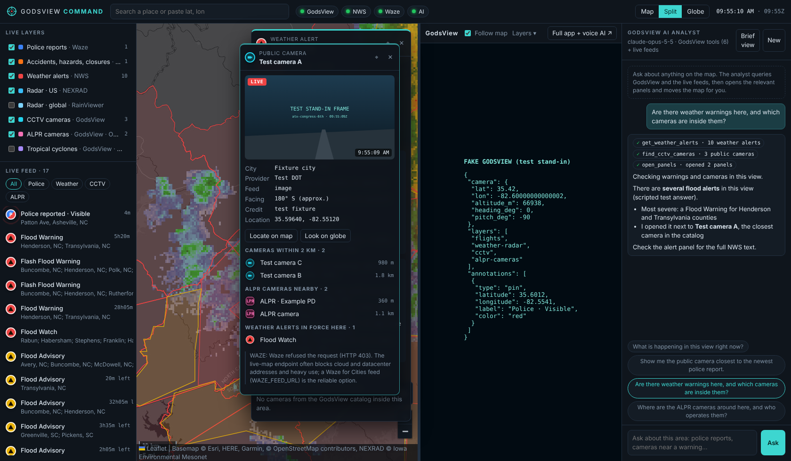

# GodsView Command

A live-map command center that runs **God's Eye View** ("GodsView",
[bilawalsidhu/gods-eye-view](https://github.com/bilawalsidhu/gods-eye-view))
alongside it, and opens live data as panels:

- **Weather events**: US National Weather Service warnings, watches and
  advisories, drawn as their real areas, plus US NEXRAD and global radar.
- **ALPR cameras**: license plate reader locations mapped in OpenStreetMap,
  read through GodsView's `find_alpr_cameras` tool.
- **CCTV**: GodsView's public traffic and city cameras, with the live still
  or video in a panel.
- **Police reported on Waze**, plus accidents, hazards and road closures.
- **Tropical cyclones** and a **situation brief** from GodsView.

Everything is connected. A police report's panel lists the nearest cameras,
ALPR readers and the weather alerts in force there. A flood warning's panel
lists the cameras and reports inside its area. Click any of them to open
it too.

Two kinds of AI run at the same time:

- **The analyst** in the console is Claude, using GodsView's own MCP tools
  plus the console's feeds. Ask "show me the camera closest to the newest
  police report" and it queries the data, opens the panels and moves the map.
- **GodsView's voice AI** runs in the full GodsView app. The **Full app +
  voice AI ↗** button opens it in its own window at the console's current
  view.



<sub>Screenshot from a test run. The NWS flood alerts and radar are live. The
cameras, ALPR readers and globe pane come from the GodsView test stand-in in
`test/fixtures`. The Waze reports are sample data, because Waze blocks the
cloud machine the screenshot was taken on. The analyst's answer is from a
scripted test model.</sub>

## Start here

There are two ways to run it. Both open the console in your browser for you,
so you never have to type an address.

| | Run on GitHub (Codespaces) | Run on your computer |
| --- | --- | --- |
| Install anything? | No | Node.js (one installer) |
| Works on | Any computer with a browser | Windows, macOS, Linux |
| Everything works? | Mostly: Waze and GodsView's voice AI don't (see below) | Yes |
| Cost | Free monthly hours on personal GitHub accounts | Free |

### Option A: run it on GitHub, nothing to install

[](https://codespaces.new/simonsspamacct-del/godsview-command?quickstart=1)

1. Click the button above (you need to be signed in to GitHub), then
   **Create codespace**.
2. Wait. The first time takes about 5–10 minutes: GitHub installs the console
   and downloads and installs GodsView. You can watch it in the terminal at
   the bottom of the editor.
3. The console opens in a new browser tab by itself. If your browser blocked
   the pop-up, open the **Ports** tab at the bottom of the editor and click
   the globe icon next to **GodsView Command (5050)**.
4. Optional, for the AI analyst: add your Anthropic API key as a Codespaces
   secret named `ANTHROPIC_API_KEY` at
   [github.com/settings/codespaces](https://github.com/settings/codespaces),
   give it access to this repository, then restart the codespace.

Next time, open the same codespace from
[github.com/codespaces](https://github.com/codespaces). It starts in under a
minute. Stop it there when you are done, so it doesn't use up your free
hours.

What's different in a codespace:
- **Waze** usually refuses requests from GitHub's servers, so the police
  layer stays empty there. Run it on your computer for Waze.
- **GodsView's voice AI** refuses requests that arrive through a proxy, as
  codespaces do, so use it in a local run. GodsView's globe and data work.
- If the globe pane says it won't show, click **Open GodsView in a new tab**.

### Option B: run it on your computer

**1. Install Node.js** (once). Download the **LTS** installer (version 24 or
later) from [nodejs.org](https://nodejs.org/en/download) and run it. On
Windows, restart your computer afterwards.

**2. Get the code.** Easiest: download
[the ZIP](https://github.com/simonsspamacct-del/godsview-command/archive/refs/heads/main.zip)
and unzip it. Or, with Git:
`git clone https://github.com/simonsspamacct-del/godsview-command.git`

**3. Start it.**

- **Windows:** open the folder and double-click **`start.bat`**. If Windows
  shows "Windows protected your PC", click **More info**, then **Run anyway**.
- **macOS:** open the folder and double-click **`start.command`**. The first
  time, macOS may refuse to open it because it was downloaded. Open
  **System Settings → Privacy & Security**, scroll down, and click
  **Open Anyway** next to the message about `start.command`. Then
  double-click it again.
- **Linux:** in a terminal, `cd` into the folder and run `./start.sh`.

A window opens and sets everything up the first time:
- installs the packages the console needs
- creates the `.env` settings file
- asks whether to download and install GodsView (say yes; it needs Git and
  takes a few minutes the first time)

Then your browser opens the console at **http://localhost:5050**. Keep that
window open while you use the console. Close it, or press Ctrl+C, to stop.

**4. Optional settings.** Open `.env` in a text editor:
- `ANTHROPIC_API_KEY=` — your Anthropic API key, for the AI analyst chat.
- `NWS_USER_AGENT=` — put your email in place of `you@example.com`; the
  weather service asks for it.

Then close the window and start again.

### Why "localhost" links don't open

`localhost:5050` means "the console running on *this* computer". It only
opens on the computer where the start window is running, and only while it
runs. That's why the links in a chat, on your phone, or on another computer
don't open. If the console is running and the page still won't load, try
http://127.0.0.1:5050, and read the start window for an error message.

### Running GodsView yourself

The console starts GodsView for you. To run GodsView separately instead, set
`GEV_AUTOSTART=0` in `.env`, then add this line to **gods-eye-view/.env**
before starting it. Without it, GodsView refuses to be embedded:

```
GEV_EMBED_FRAME_ANCESTORS=http://localhost:5050 http://127.0.0.1:5050
```

GodsView's own optional keys (Cesium ion, Google Maps, OpenAI for its voice
agent, AISStream...) are set in GodsView through its **POWER UP** panel,
not here.

## How it fits together

```
 Browser ─────────────────────────────────────────────────────────────┐
 │  Live map (Leaflet)  │  GodsView globe (iframe, ?embed=1)  │ Analyst │
 └──────────┬───────────────────────┬──────────────────────────┬──────┘
            │ /api/layers/*         │ postMessage gev:view     │ /api/ai/chat
            ▼                       ▼                          ▼
 GodsView Command server (Node, this repo) ──── Claude Messages API
   ├─ NWS alerts, RainViewer radar, Waze reports, Nominatim place search
   ├─ /api/cctv/* proxy ───────────┐
   └─ MCP client (POST /mcp) ──────┴──► God's Eye View dev server (:4173)
      started by this app from GEV_DIR, or one you run yourself
```

- The console starts GodsView (`npm run dev` in `GEV_DIR`) if nothing answers
  at `GEV_URL`, and stops it on exit.
- Its server calls GodsView's local MCP endpoint (`/mcp`) for cameras, ALPR,
  cyclones, briefs and share links.
- The globe pane uses GodsView's documented embed protocol: the console posts
  `gev:view` messages (camera, layers and pins for police reports), so the 3D
  globe follows the 2D map.

## Using it

- **Layers** (left): toggle each source. Counts and status notes show what
  loaded, what needs you to zoom in, and what failed.
- **Live feed**: everything in view, newest police reports first. Click a
  row, or a marker, to open its panel.
- **Panels** float over the map. Drag them by the header. Each one updates
  live (camera stills every 5 s, report ages) and lists related data nearby.
  **Look on globe** points the GodsView camera at the item, from a camera's
  own heading.
- **Follow map** keeps the globe on the map's view. **Layers ▾** adds
  globe-only layers (flights, traffic, earthquakes, fire perimeters,
  lightning, satellites).
- **Brief view** asks GodsView's `situation_brief` tool for the area. It needs
  no AI key.
- New police reports in view pop up as toasts.

## Data sources and their limits

| Layer | Source | Notes |
| --- | --- | --- |
| Weather alerts | [api.weather.gov](https://www.weather.gov/documentation/services-web-api) | US only. Most alerts name forecast zones instead of carrying a polygon. Zone shapes are fetched as needed, cached for a day, and fill in over a few refreshes in a large view. |
| Radar · US | Iowa Environmental Mesonet NEXRAD tiles | Refreshed every 5 minutes. |
| Radar · global | RainViewer | Native resolution up to zoom 7. |
| CCTV | GodsView camera catalog | Covers the regions GodsView ships camera packs for. Positions and headings are approximate. |
| ALPR | OpenStreetMap via GodsView | Camera locations and tags mapped by volunteers. City-sized areas only (zoom in). No plate data. |
| Waze | waze.com live map, or a Waze for Cities feed | The live-map endpoint is not a published API. Waze may refuse it, and it nearly always refuses cloud servers. A [Waze for Cities](https://www.waze.com/wazeforcities) partner feed (`WAZE_MODE=feed`) is the supported route. Reports are unverified. |
| Cyclones | NHC / CPHC via GodsView | |
| Place search | OpenStreetMap Nominatim | Only on search, as its usage policy asks. |

## The analyst

- **Model:** Claude Opus 5.5 (`claude-opus-5-5`) by default; set
  `ANTHROPIC_MODEL` and `AI_EFFORT` to change it.
- **Tools:** every tool GodsView's MCP server lists, plus five console tools:
  `get_waze_reports`, `get_weather_alerts`, `get_nearby`, `open_panels`, and
  `focus_map` to move your map.
- **Context:** each question carries your current view (center, zoom,
  bounding box, layers on). "Here" means what you are looking at.
- **Refusal fallback:** requests opt into the API's server-side refusal
  fallback (`fallbacks: "default"`), so a request a safety classifier
  declines is retried on Anthropic's recommended fallback model instead of
  failing.
- **Cost:** every question costs API tokens, usually a few model calls per
  question. The console works without a key; only the chat needs one.

## Privacy and safety

- The console and GodsView listen on localhost only. GodsView's MCP endpoint
  refuses anything that isn't this machine.
- The console shows where public cameras and ALPR readers are mounted, and
  crowd reports. It does not read plates, identify people or track vehicles,
  and the analyst is told to decline requests to.
- Data can be delayed, incomplete or wrong. Do not use it for navigation or
  emergencies; call local emergency services.

## Development

```bash
npm start            # the launcher: set up if needed, then start (same as the start files)
npm run serve        # just the server, no setup steps
npm run check        # set up, start, load the page, stop: pass or fail
npm test             # unit and end-to-end tests, no network needed
node test/fixtures/fake-gev.js 4173    # a GodsView stand-in with fixture cameras
```

The end-to-end test runs the server against the GodsView stand-in and a
scripted fake of the Messages API. It checks the layers, the camera proxy,
share links, and the analyst's tool loop.

### Automatic checks on GitHub

`.github/workflows/ci.yml` runs on every push and pull request, and from the
**Actions** tab with **Run workflow**:

- **Tests** on Windows, macOS and Linux with Node 22 and 24: `npm test`,
  then `npm run check` starts the console and loads the page.
- **Full stack**: downloads and installs the real God's Eye View, starts the
  console (which starts GodsView), and runs `scripts/integration-check.mjs`.
  It checks that GodsView comes online, answers over MCP, allows the globe
  pane, and returns share links. NWS, Waze and ALPR results are reported as
  warnings only, because they depend on outside services.

| Path | What it is |
| --- | --- |
| `start.bat`, `start.command`, `start.sh` | Double-click / one-command starters for Windows, macOS, Linux |
| `scripts/start.mjs` | The launcher they run: checks, setup, start |
| `scripts/integration-check.mjs` | Full-stack check of a running console and GodsView |
| `.devcontainer/` | GitHub Codespaces setup |
| `.github/workflows/ci.yml` | Automatic checks on GitHub |
| `server.js` | HTTP server and routes |
| `lib/gev.js` | Starts and supervises GodsView; MCP client |
| `lib/feeds/` | NWS, Waze, radar and GodsView-backed layers |
| `lib/nearby.js` | Related live data around a point |
| `lib/ai.js` | The analyst's tool loop |
| `public/js/` | Map, globe pane, panels, feed, chat |

## Troubleshooting

- **http://localhost:5050 won't open.** See
  [Why "localhost" links don't open](#why-localhost-links-dont-open). In
  short: start the console with `start.bat`, `start.command` or `./start.sh`,
  keep that window open, and open the page on the same computer. The window
  says what's wrong if it can't start: Node missing or too old, a package
  install that failed, or the port in use.
- **Check it yourself.** `npm run check` sets up, starts the console, loads
  the page and stops, with a clear pass or fail. With the console running,
  `node scripts/integration-check.mjs` also checks GodsView and each feed.
- **Windows: "Node.js is not installed" right after installing it.** Restart
  the computer so Windows picks up the new install, then start again.
- **The globe pane says GodsView won't show.** Click **Open GodsView in a
  new tab**. If you run GodsView yourself, add `GEV_EMBED_FRAME_ANCESTORS`
  to its `.env` (see [Running GodsView yourself](#running-godsview-yourself))
  and restart it.
- **The GodsView pill stays red.** GodsView needs Node.js 24.14 or later.
  Run the start file again: it offers to download and install GodsView.
  GodsView's last log lines appear in the globe pane.
- **Waze shows "refused (HTTP 403)".** Waze blocked the request, as it does
  for cloud servers, including codespaces. Run it from a home connection, or
  use a Waze for Cities feed.
- **ALPR or Waze says to zoom in.** Both only load city-sized areas.
